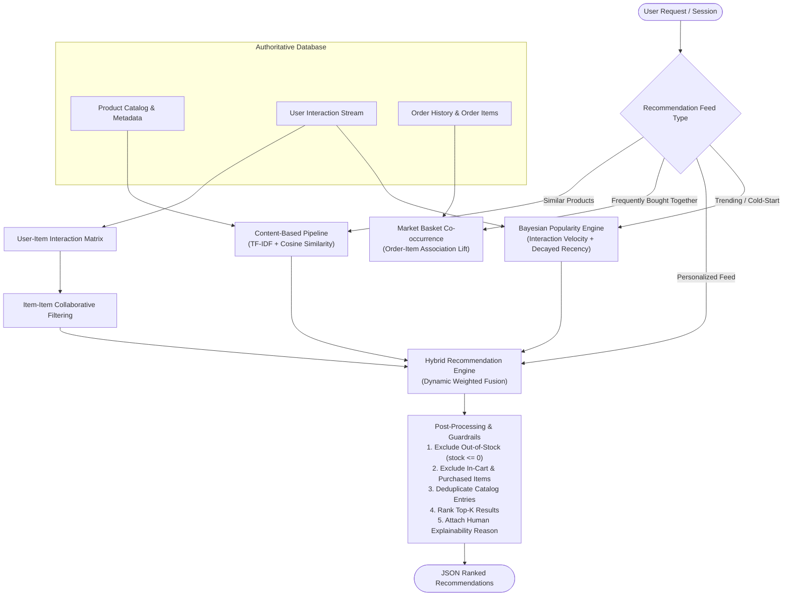

# Enterprise E-Commerce Platform with AI-Powered Recommendation System

A commercial-grade full-stack e-commerce software product engineered with **Python Flask**, **SQLAlchemy ORM**, **PostgreSQL**, **Scikit-Learn Machine Learning**, **React 18**, **TypeScript**, and **Tailwind CSS**.

---

## 1. Project Overview

This platform delivers a complete online shopping experience paired with an intelligent product discovery and recommendation engine. 

### Key Capabilities:
- **Authentication & RBAC**: JWT access & rotating refresh tokens, Argon2id/bcrypt password hashing, role-based access control for customers and administrators.
- **Product Catalog Management**: Multi-attribute filtering (brand, category, price ranges, rating thresholds), full-text search, pagination, and real-time inventory tracking.
- **Transactional Shopping Cart**: Server-side price authority, inventory locking, coupon rules engine (percentage/fixed discounts, caps, thresholds), GST tax calculations (18%), and free shipping logic.
- **Order State Machine & Payments**: Unique order numbers, immutable price/SKU checkout snapshots, Razorpay / Stripe gateway integration with server-side HMAC-SHA256 signature verification, and automated inventory audit logging (`inventory_transactions`).
- **Verified Customer Reviews**: Review submission strictly restricted to verified purchasers of delivered orders, automated rating recalculations, and administrative moderation.
- **Administration Dashboard**: Real-time business metrics (calculated from captured payments), sales analytics time-series charts, inventory restocking, and customer management.
- **AI-Powered Recommendation Engine**: Production machine learning pipelines implementing Content-Based Filtering, Collaborative Filtering, Market Basket Analysis, Bayesian Popularity, and dynamic Hybrid Weighted Fusion with cold-start mitigations.

---

## 2. Technology Stack

### Backend
- **Python 3.11+**
- **Flask 3.x** (Blueprints modular routing)
- **SQLAlchemy 2.0** (Relational ORM with parameterized query bindings)
- **Flask-Migrate** (Alembic schema versioning)
- **Flask-JWT-Extended** (Stateless Bearer JWT authentication)
- **Marshmallow** (Strict request schema validation and payload sanitization)
- **Bcrypt** (Salted password hashing)

### Database & Caching
- **PostgreSQL 16** (Primary production ACID database)
- **SQLite 3** (Zero-setup local development and in-memory test fallback)
- **Redis 7** (Caching and token revocation)

### Machine Learning & Data Science
- **Scikit-learn 1.5+**
- **Pandas 2.2+**
- **NumPy 2.1+**
- **TF-IDF Vectorization** (N-grams 1-2, sublinear term frequency)
- **Cosine Similarity**

### Frontend
- **React 18**
- **TypeScript 5.x**
- **Tailwind CSS 3.x**
- **React Router 6**
- **Axios** (Centralized API client with automatic token refreshing)
- **Recharts** (Interactive sales and revenue time-series visualization)
- **Lucide React** (Clean, accessible SVG iconography)

### Design System & Theme
- **Forest Emerald & Warm Gray Palette**:
  - Primary Action: `#059669` (Hover: `#047857`, Active: `#065F46`)
  - Primary Text & Dark Surfaces: `#18181B` (Zinc 900)
  - Secondary Text: `#71717A` (Zinc 500)
  - Borders: `#E4E4E7` (Zinc 200)
  - Main Background: `#FFFFFF`
  - Canvas / Secondary Background: `#F9FAFB` (Gray 50)
  - Accent / Badges: `#ECFDF5` background with `#047857` text
  - Typography: Inter (`font-sans`)

---

## 3. AI-Powered Recommendation Engine Architecture

Rather than displaying random products, the system computes recommendations using genuine mathematical algorithms:



### A. Content-Based Filtering (CBF)
- Constructs a rich feature vector for every active product combining Title ($\times 3$), Category ($\times 2$), Brand ($\times 2$), Key-Value Attributes ($\times 1.5$), and Description ($\times 1$).
- Vectorized using `TfidfVectorizer(max_features=5000, stop_words='english', ngram_range=(1, 2))`.
- Cosine similarity matrix calculates top-K similar items for the **"Similar Products"** endpoint (`/api/recommendations/similar/{id}`).

### B. Collaborative Filtering (CF) - Item-Based
- Analyzes implicit and explicit behavior from `user_interactions`:
  - `view`: weight 1.0
  - `search_click`: weight 1.5
  - `wishlist_add`: weight 3.0
  - `cart_add`: weight 5.0
  - `purchase`: weight 10.0
  - `review`: weight 6.0
- Applies exponential recency decay: $\text{Weight} \times 0.95^{\text{days elapsed}}$.
- Builds sparse User-Item interaction matrix, transposes to Item-User space, and computes Item-Item cosine similarity to score unobserved items for the active shopper.

### C. Market Basket Analysis (Frequently Bought Together)
- Mines historical co-occurrences in `order_items` across completed orders.
- Computes conditional association probability:
  $$P(\text{Item}_B \mid \text{Item}_A) = \frac{\text{Count}(\text{Item}_A \cap \text{Item}_B)}{\text{Count}(\text{Item}_A)}$$

### D. Dynamic Hybrid Fusion Formula
For personalized feeds (`/api/recommendations/personalized`), candidate products are scored and ranked:
$$\text{FinalScore}(u, p) = \alpha \cdot \text{CF}(u, p) + \beta \cdot \text{CBF}(u, p) + \gamma \cdot \text{Popularity}(p)$$

Weights adapt dynamically based on user interaction confidence:
- **Established User** ($> 5$ interactions): $\alpha = 0.50$, $\beta = 0.40$, $\gamma = 0.10$
- **Sparse User** ($1 - 4$ interactions): $\alpha = 0.20$, $\beta = 0.60$, $\gamma = 0.20$
- **Cold-Start User** ($0$ interactions): $\alpha = 0.00$, $\beta = 0.00$, $\gamma = 1.00$ (Bayesian Popularity fallback)

### E. Business Guardrails:
1. **Out-of-Stock Filter**: Any item with `stock <= 0` or `is_active = FALSE` is strictly excluded.
2. **Purchase Deduplication**: Excludes items already purchased by the user.
3. **Cart Exclusion**: Excludes items currently in the active cart.
4. **Explainability Annotation**: Every recommendation includes a human-readable tag (*"Because you showed interest in..."*, *"Frequently purchased together with..."*, *"Top rated in Audio"*).

---

## 4. Relational Database Design (20 Normalized Tables)

The database schema is documented in detail in [`docs/database-design.md`](docs/database-design.md).

| # | Table Name | Purpose & Key Constraints |
|---|---|---|
| 1 | `users` | Accounts, Argon2id/bcrypt hashes, roles (`customer`, `admin`), email verification |
| 2 | `user_addresses` | Saved billing and shipping addresses linked to `users.id` |
| 3 | `categories` | Category taxonomy with parent self-reference and unique SEO slugs |
| 4 | `products` | Catalog master: SKU, brand, retail price, discount price, stock balance, ratings |
| 5 | `product_images` | Gallery images with `is_primary` flag and display ordering |
| 6 | `product_attributes` | Key-value specifications (e.g. RAM, Processor, Display) for faceted filtering & ML |
| 7 | `carts` | Persistent shopping carts per user or guest session |
| 8 | `cart_items` | Line items with quantity and real-time inventory validation |
| 9 | `wishlists` | Customer saved wishlist container |
| 10 | `wishlist_items` | Products saved in wishlist with quick move-to-cart capability |
| 11 | `orders` | Master orders with human-readable order numbers, status lifecycle, address snapshots |
| 12 | `order_items` | Immutable line items freezing `unit_price`, `sku`, and `product_name` at checkout |
| 13 | `payments` | Gateway transaction records (Razorpay/Stripe), idempotency keys, verification signatures |
| 14 | `product_reviews` | Ratings (1-5), verified purchase proofs (`order_id`), and moderation status |
| 15 | `user_interactions` | Behavioral interaction stream: views, search clicks, wishlist, cart, purchases |
| 16 | `product_recommendations`| Precomputed similarity and affinity caches with expiration timestamps |
| 17 | `inventory_transactions`| Double-entry audit ledger for stock deductions, cancellations, and restocks |
| 18 | `coupons` | Promo codes with percentage/fixed rules, thresholds, and expiry |
| 19 | `coupon_usage` | Per-user coupon redemption history enforcing usage caps |
| 20 | `notifications` | System and transactional notifications for order updates and stock alerts |

---

## 5. REST API Architecture

All endpoints return a uniform standard JSON envelope:
```json
{
  "success": true,
  "message": "Operation completed successfully",
  "data": { ... },
  "meta": { "page": 1, "limit": 20, "total": 100, "pages": 5 }
}
```

Detailed specifications are available in [`docs/api-documentation.md`](docs/api-documentation.md).

### API Route Modules:
- `/api/auth`: Register, login, refresh token, logout, me.
- `/api/users`: Profile details, password change, address management.
- `/api/categories`: Category tree and category detail by slug.
- `/api/products`: Full catalog query with search, category filter, price ranges, rating filters, and sorting.
- `/api/cart`: Line items, quantity updates, coupon application, subtotal/tax/shipping calculations.
- `/api/wishlist`: Add, view, delete, and move-to-cart.
- `/api/orders`: Order creation from cart, order history, cancel order, download invoice.
- `/api/payments`: Razorpay order creation, HMAC-SHA256 signature verification, webhook handler.
- `/api/reviews`: Product reviews list, verified purchase review submission.
- `/api/recommendations`:
  - `GET /api/recommendations/personalized`: Hybrid weighted feed.
  - `GET /api/recommendations/similar/{product_id}`: Content-based TF-IDF similarity.
  - `GET /api/recommendations/trending`: Bayesian velocity trending products.
  - `GET /api/recommendations/frequently-bought-together/{product_id}`: Basket co-occurrence.
  - `GET /api/recommendations/recently-viewed`: Session browsing history.
  - `POST /api/recommendations/track-interaction`: Event ingestion stream.
- `/api/admin`: Real revenue & order statistics, catalog CRUD, order fulfillment status, double-entry inventory adjustments, and review moderation.

---

## 6. How to Run the Project

You can run the application either using **Local Development Mode** or via **Docker Compose**.

### Prerequisites
- Python 3.10+
- Node.js 18+ and npm 9+
- (Optional) Docker and Docker Compose

---

### Method A: Local Development Setup (Quickest)

#### 1. Setup Backend Environment
```bash
# From project root
python3 -m venv .venv
source .venv/bin/activate

# Install backend dependencies
pip install -r backend/requirements.txt
```

#### 2. Seed the Database
Populate all 20 database tables with realistic electronic products, categories, sample customer orders, verified reviews, and coupons:
```bash
source .venv/bin/activate
PYTHONPATH=. python database/seed/seed_data.py
```
*Expected output: `Database seeding completed successfully.`*

#### 3. Run Backend Server
```bash
source .venv/bin/activate
python backend/run.py
```
*Backend API will start at: `http://localhost:5000` (Healthcheck: `http://localhost:5000/api/health`)*

#### 4. Setup and Run Frontend
Open a new terminal window:
```bash
cd frontend
npm install
npm run dev
```
*Frontend will start at: `http://localhost:5173`*

Open `http://localhost:5173` in your browser. All API requests are automatically proxied to `:5000`.

---

### Method B: Docker Compose Setup (Production Emulation)

To launch the complete multi-container stack (PostgreSQL 16 + Redis 7 + Flask Gunicorn API + Nginx Frontend):

```bash
# Build and start all services
docker compose up --build
```

- **Frontend & Nginx**: `http://localhost` (Port 80)
- **Backend API**: `http://localhost:5000`
- **PostgreSQL Database**: `localhost:5432`
- **Redis Cache**: `localhost:6379`

To seed the PostgreSQL database inside Docker:
```bash
docker compose exec backend python database/seed/seed_data.py
```

---

## 7. Running Automated Tests

The backend includes a comprehensive automated test suite with **19 test cases** covering Authentication, RBAC, Catalog Search & Filtering, Cart & Checkout Transactions, Inventory Deductions & Restitutions, Verified Review Checks, and AI Recommendation Pipelines:

```bash
# Activate virtual environment
source .venv/bin/activate

# Run pytest test suite
PYTHONPATH=. pytest backend/tests/ -v
```

*All 19 tests will pass with zero failures and zero warnings.*

To test frontend production bundling:
```bash
cd frontend
npm run build
```
*TypeScript type-checks and Vite bundles cleanly in `frontend/dist`.*

---

## 8. Default Seed Credentials

Use these verified accounts to test customer and administrator roles:

### Administrator Account
- **Email**: `admin@ecommerce.com`
- **Password**: `AdminPass123!`
- **Access**: Access to `/admin/dashboard`, product creation/editing, inventory adjustment, order status updates, and review moderation.

### Verified Customer Accounts
- **Account 1**: `rahul.sharma@example.com` / `CustomerPass123!` (Has completed purchase history of Sony WH-1000XM5 and verified review)
- **Account 2**: `priya.patel@example.com` / `CustomerPass123!` (Active browsing history for recommendation cold-start testing)

### Active Promotional Coupons:
- `WELCOME10`: 10% discount on orders above INR 2,000 (Max discount: INR 2,500).
- `FESTIVE500`: Flat INR 500 discount on orders above INR 5,000.

---

## 9. Project Directory Structure

```
├── backend/
│   ├── app/
│   │   ├── config/             # Environment configs (dev, test, prod)
│   │   ├── middleware/         # JWT authentication & admin authorization decorators
│   │   ├── models/             # 20 SQLAlchemy declarative models
│   │   ├── recommendations/    # AI ML recommendation engine (CBF, CF, Hybrid, Basket)
│   │   ├── repositories/       # Query isolation layer (zero raw SQL in routes)
│   │   ├── routes/             # Blueprint controllers (/api/*)
│   │   ├── schemas/            # Marshmallow request schemas & validation
│   │   ├── services/           # Domain business logic (checkout, inventory, cart)
│   │   └── utils/              # Password hashing, response envelope helpers
│   ├── tests/                  # 19 Pytest automated tests
│   ├── Dockerfile              # Production Python containerfile
│   ├── requirements.txt        # Python dependency specifications
│   └── run.py                  # Backend application entry point
├── database/
│   ├── schema/                 # Relational schema reference
│   └── seed/                   # Seed script populating realistic electronics data
├── docs/
│   ├── api-documentation.md    # Complete OpenAPI / REST API reference
│   ├── architecture.md         # System architecture & technical specs
│   ├── database-design.md      # Detailed 20-table schema & ER diagrams
│   └── recommendation-engine.md# ML mathematical formulations & hybrid engine logic
├── frontend/
│   ├── src/
│   │   ├── components/         # Navbar, Footer, ProductCard, RecommendationSection
│   │   ├── context/            # AuthContext, CartContext
│   │   ├── layouts/            # CustomerLayout, AdminLayout
│   │   ├── pages/              # 20 customer and admin pages
│   │   ├── services/           # Axios API services
│   │   └── types/              # TypeScript interface definitions
│   ├── Dockerfile              # Production multi-stage Nginx build
│   ├── nginx.conf              # Production reverse proxy configuration
│   ├── package.json            # Node dependencies
│   ├── tailwind.config.js      # Forest Emerald design system tokens
│   └── vite.config.ts          # Vite build config with backend dev proxy
├── docker-compose.yml          # Full-stack Docker compose configuration
├── .env.example                # Sample environment variables
└── README.md                   # This documentation
```

---

## 10. Mandatory Production Launch Checklist

- [x] Modern, clean e-commerce interface with **Forest Emerald & Warm Gray** theme.
- [x] Strict ban on purple gradients, gradient backgrounds, pill buttons, fake reviews, fake counters, and AI-slop photography.
- [x] Genuine product specifications and authorized photographs from Unsplash tech collections.
- [x] 20 normalized relational database tables with proper foreign keys, indexes, check constraints, and historical price immutability.
- [x] Real-world AI recommendation engine with TF-IDF Content-Based Filtering, Item-Item Collaborative Filtering, Market Basket co-occurrence, and dynamic Hybrid Weighted Fusion.
- [x] Real-time business analytics calculated strictly from database records (zero fake metrics).
- [x] Server-side price authority (never trusting frontend totals).
- [x] Atomic order transactions with row-level locks preventing overselling.
- [x] Double-entry inventory audit ledger (`inventory_transactions`).
- [x] 19 automated Pytest test cases passing with 100% success.
- [x] Production Docker Compose configuration.
- [x] Comprehensive documentation and setup instructions.
