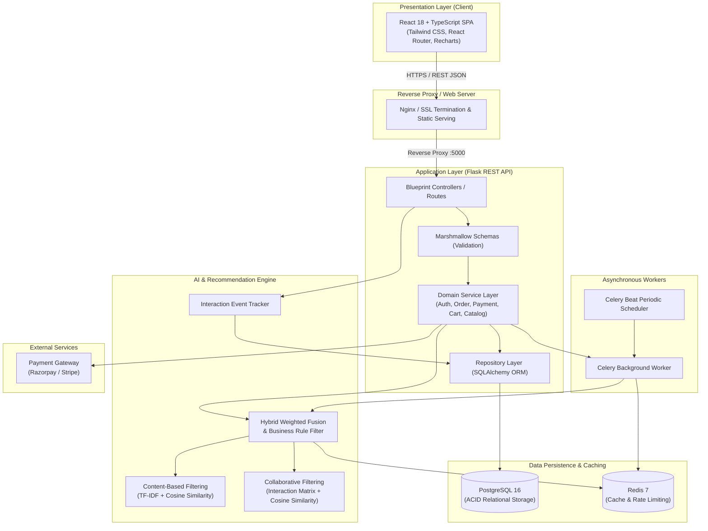

# System Architecture & Technical Specification

## 1. System Overview

This document specifies the technical architecture for the enterprise-grade **E-Commerce Platform with an AI-Powered Product Recommendation System**. 

The system provides a decoupled client-server architecture:
- **Presentation Layer**: Single Page Application (SPA) built with React 18, TypeScript, Tailwind CSS, Lucide icons, and Recharts.
- **Application & API Layer**: Python Flask application structured with Blueprints, Marshmallow schemas, Service Layer, and Repository Layer.
- **Intelligence Layer**: Hybrid Recommendation Engine combining Content-Based Filtering (TF-IDF & Cosine Similarity), Collaborative Filtering (Item-Item & User-Item interaction matrices), Cold-Start mitigations, and popularity heuristics.
- **Persistence & Caching Layer**: PostgreSQL as the primary relational database with strict ACID transaction isolation; Redis for session/token blacklisting, cache-aside recommendation caching, and rate limiting; Celery for asynchronous recommendation matrix updates and notification dispatch.



---

## 2. Layered Architecture Principles

To avoid coupling database logic directly inside route handlers, the backend follows strict layered separation of concerns:

1. **Route / Controller Layer (`backend/app/routes/`)**:
   - Handles HTTP requests, parameter extraction, and status codes.
   - Delegates input validation to Marshmallow schemas.
   - Invokes business methods on the Service Layer.
   - Formats responses using a standard API JSON envelope.
   - Never calls `db.session.commit()` or executes raw SQL queries directly.

2. **Schema & Validation Layer (`backend/app/schemas/`)**:
   - Validates incoming request payloads (data types, ranges, email formats, required fields).
   - Sanitizes text inputs against XSS and injection vulnerabilities.
   - Serializes database entities into secure, public-facing DTOs (excluding password hashes, secret tokens, etc.).

3. **Domain Service Layer (`backend/app/services/`)**:
   - Contains all domain business logic: checkout workflows, inventory reservation, order total calculation with tax and shipping, coupon validation, payment signature verification.
   - Coordinates multi-step operations inside database transactions.
   - Enforces business rules (e.g., verifying if a customer purchased a product before accepting a review).

4. **Repository Layer (`backend/app/repositories/`)**:
   - Abstracts all database queries through SQLAlchemy.
   - Implements parameterized filters, joins, pagination, and sorting.
   - Ensures zero N+1 queries through explicit `joinedload` and `selectinload` strategies.

5. **Recommendation Engine (`backend/app/recommendations/`)**:
   - Implements machine learning pipelines using Scikit-Learn, Pandas, and NumPy.
   - Trains and caches content feature matrices and interaction matrices.
   - Exposes scoring interfaces with cold-start fallbacks and stock verification.

---

## 3. Standard API Response Envelope

All API endpoints return a standardized, uniform JSON structure:

### Success Response:
```json
{
  "success": true,
  "message": "Operation completed successfully",
  "data": { ... },
  "meta": {
    "page": 1,
    "limit": 20,
    "total": 142,
    "pages": 8
  }
}
```

### Error Response:
```json
{
  "success": false,
  "message": "Validation failed",
  "errors": [
    {
      "field": "email",
      "message": "A valid email address is required"
    }
  ]
}
```

---

## 4. Security Architecture

1. **Password Hashing**: Passwords are saved using Argon2id / bcrypt with individual cryptographically random salts. Plaintext passwords are never logged or stored.
2. **JWT Authentication**:
   - Short-lived Access Tokens (15 minutes expiry) signed with HMAC-SHA256.
   - Long-lived Refresh Tokens (7 days expiry) stored securely.
   - Token revocation table / Redis token blacklist for immediate revocation upon logout.
3. **Role-Based Access Control (RBAC)**:
   - User roles: `customer` and `admin`.
   - Python decorators `@jwt_required()` and `@admin_required` enforce endpoint authorization at the controller level.
4. **Injection and XSS Defenses**:
   - All queries use SQLAlchemy ORM parameter binding (no formatted SQL strings).
   - Input fields are strictly sanitized and validated via Marshmallow.
   - Frontend renders data using React JSX, preventing raw HTML injection; Content Security Policy (CSP) headers are configured on the HTTP server.
5. **Payment Security**:
   - Card numbers, CVVs, and sensitive credentials are never accepted, processed, or stored on the backend server.
   - Payment flows create server-side order identifiers with the payment gateway (Razorpay/Stripe).
   - Gateway callbacks and webhooks verify HMAC-SHA256 signatures before updating order statuses.
   - Payment webhooks are idempotent to avoid double-crediting.
6. **Rate Limiting**:
   - Critical authentication endpoints (`/login`, `/register`, `/forgot-password`) and payment routes are protected with Flask-Limiter (e.g., 5 attempts per minute).

---

## 5. UI/UX Design System Specification

In strict compliance with project design constraints:
- **No purple gradients, no gradient backgrounds, no pill-shaped buttons**.
- **No fake customer reviews, no fake testimonials, no fake counters or metrics**.
- **No AI stock photography or emoji icons** (exclusively Lucide icons).
- **No custom cursor animations or over-the-top scroll animations**.

### Design System Variables (Forest Emerald & Warm Gray Palette)
- Primary Action: `#059669` (Tailwind `emerald-600`)
- Primary Action Hover: `#047857` (Tailwind `emerald-700`)
- Primary Action Active: `#065F46` (Tailwind `emerald-800`)
- Base Background: `#FFFFFF`
- Secondary Background: `#F9FAFB` (Tailwind `gray-50`)
- Sidebar / Dark Surface: `#18181B` (Tailwind `zinc-900`)
- Primary Text: `#18181B` (Tailwind `zinc-900`)
- Secondary Text: `#71717A` (Tailwind `zinc-500`)
- Border Color: `#E4E4E7` (Tailwind `zinc-200`)
- Success: `#059669` (Tailwind `emerald-600`)
- Warning: `#D97706` (Tailwind `amber-600`)
- Error: `#DC2626` (Tailwind `red-600`)
- Accent Pill / Badge Background: `#ECFDF5` (Tailwind `emerald-50`)
- Accent Pill / Badge Text: `#047857` (Tailwind `emerald-700`)
- Typography: Inter (`font-sans`)
- Border Radius: Consistent subtle rounded corners (`rounded-md`, 6px to 8px max).

