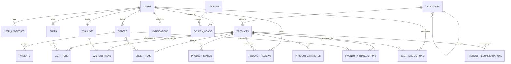

# Database Design Specification

## 1. Overview & Rationale

The database is built on **PostgreSQL** using **SQLAlchemy 2.0** ORM and **Flask-Migrate** (Alembic). It satisfies 3rd Normal Form (3NF) requirements while preserving historical order accuracy (historical prices at time of purchase) and maintaining strict audit trails for stock inventory adjustments.

### Key Relational Rules:
- **UUID Primary Keys** for security and decentralized generation where appropriate, and serialized integer IDs for customer-facing order tracking.
- **Historical Immutability**: `order_items` stores historical snapshots of `unit_price`, `product_name`, and `sku` at the exact millisecond of checkout. Changes in the product catalog never modify completed orders.
- **Inventory Concurrency & Integrity**: Stock adjustments are logged in `inventory_transactions` within database transactions (`SELECT ... FOR UPDATE`) to prevent race conditions and overselling.
- **Cascading Rules**: Deleting a category sets product category to null (or restricts if products exist). Deleting a user soft-deletes or restricts active orders. Items in carts and wishlists cascade delete when the parent container is deleted.

---

## 2. Entity Relationship Diagram

---

## 3. Detailed Table Schema Definitions

### Table 1: `users`
Stores registered customer and administrator accounts.
| Column | Type | Constraints | Description |
|---|---|---|---|
| `id` | VARCHAR(36) / UUID | PRIMARY KEY | Unique user identifier |
| `email` | VARCHAR(255) | UNIQUE, NOT NULL, INDEX | Login email address |
| `password_hash` | VARCHAR(255) | NOT NULL | Argon2id / bcrypt salted password hash |
| `first_name` | VARCHAR(100) | NOT NULL | Customer first name |
| `last_name` | VARCHAR(100) | NOT NULL | Customer last name |
| `phone_number` | VARCHAR(30) | NULL | Contact phone number |
| `role` | VARCHAR(20) | NOT NULL, DEFAULT 'customer' | Role: 'customer', 'admin' |
| `is_active` | BOOLEAN | NOT NULL, DEFAULT TRUE | Account active status |
| `is_email_verified` | BOOLEAN | NOT NULL, DEFAULT FALSE | Email verification status |
| `email_verification_token` | VARCHAR(255) | NULL | Verification token |
| `password_reset_token` | VARCHAR(255) | NULL | Reset token hash |
| `password_reset_expires_at` | TIMESTAMP | NULL | Token expiry |
| `created_at` | TIMESTAMP WITH TIME ZONE | NOT NULL, DEFAULT NOW() | Registration timestamp |
| `updated_at` | TIMESTAMP WITH TIME ZONE | NOT NULL, DEFAULT NOW() | Last update timestamp |

### Table 2: `user_addresses`
Stores shipping and billing addresses for users.
| Column | Type | Constraints | Description |
|---|---|---|---|
| `id` | VARCHAR(36) | PRIMARY KEY | Unique address identifier |
| `user_id` | VARCHAR(36) | FK(users.id, CASCADE), NOT NULL | Owning user |
| `address_type` | VARCHAR(20) | NOT NULL, DEFAULT 'shipping' | 'shipping' or 'billing' |
| `recipient_name`| VARCHAR(150) | NOT NULL | Recipient full name |
| `phone` | VARCHAR(30) | NOT NULL | Contact phone |
| `street_address`| TEXT | NOT NULL | Address line 1 & 2 |
| `landmark` | VARCHAR(255) | NULL | Optional landmark |
| `city` | VARCHAR(100) | NOT NULL | City |
| `state` | VARCHAR(100) | NOT NULL | State or province |
| `postal_code` | VARCHAR(20) | NOT NULL, INDEX | PIN / Postal code |
| `country` | VARCHAR(100) | NOT NULL, DEFAULT 'India' | Country |
| `is_default` | BOOLEAN | NOT NULL, DEFAULT FALSE | Default address flag |
| `created_at` | TIMESTAMP WITH TIME ZONE | NOT NULL, DEFAULT NOW() | Creation timestamp |
| `updated_at` | TIMESTAMP WITH TIME ZONE | NOT NULL, DEFAULT NOW() | Update timestamp |

### Table 3: `categories`
Hierarchical product categories with slug support.
| Column | Type | Constraints | Description |
|---|---|---|---|
| `id` | VARCHAR(36) | PRIMARY KEY | Category ID |
| `parent_id` | VARCHAR(36) | FK(categories.id, SET NULL), NULL | Self-referencing parent category |
| `name` | VARCHAR(150) | NOT NULL | Category display name |
| `slug` | VARCHAR(180) | UNIQUE, NOT NULL, INDEX | SEO-friendly URL slug |
| `description` | TEXT | NULL | Category overview |
| `image_url` | TEXT | NULL | Category display image |
| `is_active` | BOOLEAN | NOT NULL, DEFAULT TRUE | Category visibility |
| `sort_order` | INTEGER | NOT NULL, DEFAULT 0 | Menu display order |
| `created_at` | TIMESTAMP WITH TIME ZONE | NOT NULL, DEFAULT NOW() | Creation timestamp |
| `updated_at` | TIMESTAMP WITH TIME ZONE | NOT NULL, DEFAULT NOW() | Update timestamp |

### Table 4: `products`
The core product catalog table.
| Column | Type | Constraints | Description |
|---|---|---|---|
| `id` | VARCHAR(36) | PRIMARY KEY | Product ID |
| `category_id` | VARCHAR(36) | FK(categories.id, RESTRICT), NOT NULL, INDEX | Primary category |
| `name` | VARCHAR(255) | NOT NULL, INDEX | Product title |
| `slug` | VARCHAR(280) | UNIQUE, NOT NULL, INDEX | SEO URL slug |
| `sku` | VARCHAR(100) | UNIQUE, NOT NULL, INDEX | Stock Keeping Unit |
| `brand` | VARCHAR(120) | NOT NULL, INDEX | Brand name |
| `description` | TEXT | NOT NULL | Full markdown/HTML description |
| `short_description` | TEXT | NULL | Brief card summary |
| `price` | NUMERIC(12, 2) | NOT NULL, CHECK(price >= 0) | Base retail price |
| `discount_price`| NUMERIC(12, 2) | NULL, CHECK(discount_price >= 0) | Discounted selling price |
| `stock` | INTEGER | NOT NULL, DEFAULT 0, CHECK(stock >= 0) | Available inventory |
| `low_stock_threshold`| INTEGER | NOT NULL, DEFAULT 5 | Low stock alert threshold |
| `average_rating`| NUMERIC(3, 2) | NOT NULL, DEFAULT 0.00 | Computed avg rating (0.00 - 5.00) |
| `reviews_count` | INTEGER | NOT NULL, DEFAULT 0 | Verified reviews counter |
| `is_active` | BOOLEAN | NOT NULL, DEFAULT TRUE, INDEX | Catalog visibility |
| `is_featured` | BOOLEAN | NOT NULL, DEFAULT FALSE | Homepage highlight flag |
| `created_at` | TIMESTAMP WITH TIME ZONE | NOT NULL, DEFAULT NOW() | Creation timestamp |
| `updated_at` | TIMESTAMP WITH TIME ZONE | NOT NULL, DEFAULT NOW() | Update timestamp |

### Table 5: `product_images`
Product photo gallery with primary display flag.
| Column | Type | Constraints | Description |
|---|---|---|---|
| `id` | VARCHAR(36) | PRIMARY KEY | Image ID |
| `product_id` | VARCHAR(36) | FK(products.id, CASCADE), NOT NULL, INDEX | Associated product |
| `image_url` | TEXT | NOT NULL | Image file URL or static path |
| `alt_text` | VARCHAR(255) | NULL | Accessibility description |
| `display_order` | INTEGER | NOT NULL, DEFAULT 0 | Gallery ordering |
| `is_primary` | BOOLEAN | NOT NULL, DEFAULT FALSE | Main thumbnail flag |
| `created_at` | TIMESTAMP WITH TIME ZONE | NOT NULL, DEFAULT NOW() | Creation timestamp |

### Table 6: `product_attributes`
Key-value attributes (e.g., Color, Size, Storage, Material) for faceted filtering and ML vectorization.
| Column | Type | Constraints | Description |
|---|---|---|---|
| `id` | VARCHAR(36) | PRIMARY KEY | Attribute ID |
| `product_id` | VARCHAR(36) | FK(products.id, CASCADE), NOT NULL, INDEX | Associated product |
| `attribute_name`| VARCHAR(100) | NOT NULL | e.g. "Color", "RAM", "Processor" |
| `attribute_value`| VARCHAR(255)| NOT NULL | e.g. "Space Gray", "16GB", "M3" |
| `created_at` | TIMESTAMP WITH TIME ZONE | NOT NULL, DEFAULT NOW() | Creation timestamp |

### Table 7: `carts`
Persistent shopping cart for each authenticated customer or guest session.
| Column | Type | Constraints | Description |
|---|---|---|---|
| `id` | VARCHAR(36) | PRIMARY KEY | Cart ID |
| `user_id` | VARCHAR(36) | FK(users.id, CASCADE), UNIQUE, NULL | Registered owner |
| `session_token` | VARCHAR(255) | UNIQUE, NULL | Guest session identifier |
| `created_at` | TIMESTAMP WITH TIME ZONE | NOT NULL, DEFAULT NOW() | Creation timestamp |
| `updated_at` | TIMESTAMP WITH TIME ZONE | NOT NULL, DEFAULT NOW() | Update timestamp |

### Table 8: `cart_items`
Line items in the active cart with real-time price verification.
| Column | Type | Constraints | Description |
|---|---|---|---|
| `id` | VARCHAR(36) | PRIMARY KEY | Cart item ID |
| `cart_id` | VARCHAR(36) | FK(carts.id, CASCADE), NOT NULL, INDEX | Parent cart |
| `product_id` | VARCHAR(36) | FK(products.id, CASCADE), NOT NULL, INDEX | Added product |
| `quantity` | INTEGER | NOT NULL, DEFAULT 1, CHECK(quantity > 0) | Selected quantity |
| `created_at` | TIMESTAMP WITH TIME ZONE | NOT NULL, DEFAULT NOW() | Timestamp |
| `updated_at` | TIMESTAMP WITH TIME ZONE | NOT NULL, DEFAULT NOW() | Timestamp |

### Table 9: `wishlists`
Customer wishlist container.
| Column | Type | Constraints | Description |
|---|---|---|---|
| `id` | VARCHAR(36) | PRIMARY KEY | Wishlist ID |
| `user_id` | VARCHAR(36) | FK(users.id, CASCADE), UNIQUE, NOT NULL | Owning user |
| `created_at` | TIMESTAMP WITH TIME ZONE | NOT NULL, DEFAULT NOW() | Creation timestamp |
| `updated_at` | TIMESTAMP WITH TIME ZONE | NOT NULL, DEFAULT NOW() | Update timestamp |

### Table 10: `wishlist_items`
Individual items saved to wishlist.
| Column | Type | Constraints | Description |
|---|---|---|---|
| `id` | VARCHAR(36) | PRIMARY KEY | Item ID |
| `wishlist_id` | VARCHAR(36) | FK(wishlists.id, CASCADE), NOT NULL | Parent wishlist |
| `product_id` | VARCHAR(36) | FK(products.id, CASCADE), NOT NULL | Saved product |
| `created_at` | TIMESTAMP WITH TIME ZONE | NOT NULL, DEFAULT NOW() | Timestamp |

### Table 11: `orders`
Master order record with transactional totals and status lifecycle.
| Column | Type | Constraints | Description |
|---|---|---|---|
| `id` | VARCHAR(36) | PRIMARY KEY | Order ID |
| `order_number` | VARCHAR(50) | UNIQUE, NOT NULL, INDEX | Human-readable order # (e.g. ORD-20261105-001) |
| `user_id` | VARCHAR(36) | FK(users.id, RESTRICT), NOT NULL, INDEX | Customer who placed order |
| `status` | VARCHAR(30) | NOT NULL, DEFAULT 'pending', INDEX | 'pending', 'confirmed', 'processing', 'shipped', 'delivered', 'cancelled', 'refunded' |
| `subtotal` | NUMERIC(12, 2) | NOT NULL, CHECK(subtotal >= 0) | Line items subtotal |
| `discount_amount`| NUMERIC(12, 2)| NOT NULL, DEFAULT 0.00 | Total discount applied |
| `tax_amount` | NUMERIC(12, 2) | NOT NULL, DEFAULT 0.00 | Computed tax (e.g. 18% GST) |
| `shipping_amount`| NUMERIC(12, 2)| NOT NULL, DEFAULT 0.00 | Shipping charge |
| `total_amount` | NUMERIC(12, 2) | NOT NULL, CHECK(total_amount >= 0) | Final payable total |
| `coupon_code` | VARCHAR(50) | NULL | Applied coupon code |
| `shipping_address_snapshot` | JSONB / TEXT | NOT NULL | Frozen shipping address at checkout |
| `billing_address_snapshot` | JSONB / TEXT | NOT NULL | Frozen billing address at checkout |
| `tracking_number` | VARCHAR(100) | NULL | Courier tracking ID |
| `notes` | TEXT | NULL | Customer / order notes |
| `cancelled_at` | TIMESTAMP WITH TIME ZONE | NULL | Cancellation timestamp |
| `cancellation_reason` | TEXT | NULL | Cancellation reason |
| `created_at` | TIMESTAMP WITH TIME ZONE | NOT NULL, DEFAULT NOW(), INDEX | Order placed timestamp |
| `updated_at` | TIMESTAMP WITH TIME ZONE | NOT NULL, DEFAULT NOW() | Last update timestamp |

### Table 12: `order_items`
Frozen line items capturing price and product snapshot at time of checkout.
| Column | Type | Constraints | Description |
|---|---|---|---|
| `id` | VARCHAR(36) | PRIMARY KEY | Line item ID |
| `order_id` | VARCHAR(36) | FK(orders.id, CASCADE), NOT NULL, INDEX | Parent order |
| `product_id` | VARCHAR(36) | FK(products.id, RESTRICT), NOT NULL, INDEX | Reference product |
| `product_name` | VARCHAR(255) | NOT NULL | Snapshot product name |
| `sku` | VARCHAR(100) | NOT NULL | Snapshot product SKU |
| `unit_price` | NUMERIC(12, 2) | NOT NULL, CHECK(unit_price >= 0) | Locked unit price at checkout |
| `quantity` | INTEGER | NOT NULL, CHECK(quantity > 0) | Purchased quantity |
| `total_price` | NUMERIC(12, 2) | NOT NULL | unit_price * quantity |
| `created_at` | TIMESTAMP WITH TIME ZONE | NOT NULL, DEFAULT NOW() | Timestamp |

### Table 13: `payments`
Stores payment gateway transaction records, webhook signatures, and statuses.
| Column | Type | Constraints | Description |
|---|---|---|---|
| `id` | VARCHAR(36) | PRIMARY KEY | Payment record ID |
| `order_id` | VARCHAR(36) | FK(orders.id, RESTRICT), NOT NULL, INDEX | Associated order |
| `gateway` | VARCHAR(50) | NOT NULL | 'razorpay' or 'stripe' |
| `gateway_order_id`| VARCHAR(100) | NOT NULL, INDEX | Gateway order reference (e.g. order_xxx) |
| `gateway_payment_id`| VARCHAR(100)| UNIQUE, NULL, INDEX | Gateway payment reference (e.g. pay_xxx) |
| `gateway_signature`| VARCHAR(255)| NULL | Signature for verification |
| `amount` | NUMERIC(12, 2) | NOT NULL | Transaction amount |
| `currency` | VARCHAR(10) | NOT NULL, DEFAULT 'INR' | Currency code |
| `status` | VARCHAR(30) | NOT NULL, DEFAULT 'pending', INDEX | 'pending', 'authorized', 'captured', 'failed', 'refunded' |
| `idempotency_key` | VARCHAR(100) | UNIQUE, NOT NULL | Prevents duplicate payments |
| `error_code` | VARCHAR(100) | NULL | Gateway failure code |
| `error_description`| TEXT | NULL | Gateway error message |
| `refund_id` | VARCHAR(100) | NULL | Gateway refund ID |
| `refund_amount` | NUMERIC(12, 2) | NULL | Refunded amount |
| `created_at` | TIMESTAMP WITH TIME ZONE | NOT NULL, DEFAULT NOW() | Creation timestamp |
| `updated_at` | TIMESTAMP WITH TIME ZONE | NOT NULL, DEFAULT NOW() | Update timestamp |

### Table 14: `product_reviews`
Customer ratings and reviews with verified purchase confirmation.
| Column | Type | Constraints | Description |
|---|---|---|---|
| `id` | VARCHAR(36) | PRIMARY KEY | Review ID |
| `product_id` | VARCHAR(36) | FK(products.id, CASCADE), NOT NULL, INDEX | Reviewed product |
| `user_id` | VARCHAR(36) | FK(users.id, CASCADE), NOT NULL, INDEX | Review author |
| `order_id` | VARCHAR(36) | FK(orders.id, SET NULL), NULL | Verified purchase order proof |
| `rating` | INTEGER | NOT NULL, CHECK(rating >= 1 AND rating <= 5) | Star rating 1 to 5 |
| `title` | VARCHAR(200) | NOT NULL | Review title |
| `comment` | TEXT | NOT NULL | Review text content |
| `is_verified_purchase`| BOOLEAN | NOT NULL, DEFAULT FALSE | Verified purchase badge |
| `is_approved` | BOOLEAN | NOT NULL, DEFAULT TRUE | Moderation approval status |
| `moderated_by` | VARCHAR(36) | FK(users.id, SET NULL), NULL | Admin moderator ID |
| `moderated_at` | TIMESTAMP WITH TIME ZONE | NULL | Moderation timestamp |
| `created_at` | TIMESTAMP WITH TIME ZONE | NOT NULL, DEFAULT NOW() | Submission timestamp |
| `updated_at` | TIMESTAMP WITH TIME ZONE | NOT NULL, DEFAULT NOW() | Update timestamp |

### Table 15: `user_interactions`
Real-time user behavior events feed for the recommendation engine.
| Column | Type | Constraints | Description |
|---|---|---|---|
| `id` | VARCHAR(36) | PRIMARY KEY | Event ID |
| `user_id` | VARCHAR(36) | FK(users.id, CASCADE), NULL, INDEX | User (null for guest) |
| `session_id` | VARCHAR(100) | NOT NULL, INDEX | Browser session ID |
| `product_id` | VARCHAR(36) | FK(products.id, CASCADE), NOT NULL, INDEX | Target product |
| `interaction_type`| VARCHAR(50)| NOT NULL, INDEX | 'view', 'search_click', 'wishlist_add', 'cart_add', 'purchase', 'review' |
| `dwell_time_seconds`| INTEGER | DEFAULT 0 | Dwell time on product page |
| `metadata` | JSONB / TEXT | NULL | Search query, referrer, category context |
| `created_at` | TIMESTAMP WITH TIME ZONE | NOT NULL, DEFAULT NOW(), INDEX | Event timestamp |

### Table 16: `product_recommendations`
Precomputed or cached product-to-product and user recommendation affinities.
| Column | Type | Constraints | Description |
|---|---|---|---|
| `id` | VARCHAR(36) | PRIMARY KEY | Recommendation ID |
| `source_product_id`| VARCHAR(36)| FK(products.id, CASCADE), NULL, INDEX | Source product for item-item similarities |
| `target_product_id`| VARCHAR(36)| FK(products.id, CASCADE), NOT NULL, INDEX | Recommended target product |
| `user_id` | VARCHAR(36) | FK(users.id, CASCADE), NULL, INDEX | Specific user for personalized cache |
| `recommendation_type`| VARCHAR(50)| NOT NULL, INDEX | 'similar', 'frequently_bought_together', 'personalized', 'trending' |
| `score` | NUMERIC(8, 4) | NOT NULL | Computed similarity / affinity score |
| `reason` | VARCHAR(255) | NULL | Explanation (e.g., "High content similarity in Audio") |
| `expires_at` | TIMESTAMP WITH TIME ZONE | NOT NULL, INDEX | Cache expiration |
| `created_at` | TIMESTAMP WITH TIME ZONE | NOT NULL, DEFAULT NOW() | Computation timestamp |

### Table 17: `inventory_transactions`
Auditable double-entry stock transaction ledger.
| Column | Type | Constraints | Description |
|---|---|---|---|
| `id` | VARCHAR(36) | PRIMARY KEY | Transaction ID |
| `product_id` | VARCHAR(36) | FK(products.id, RESTRICT), NOT NULL, INDEX | Impacted product |
| `order_id` | VARCHAR(36) | FK(orders.id, SET NULL), NULL | Associated order |
| `change_quantity`| INTEGER | NOT NULL | Positive (restock) or negative (sale/deduction) |
| `balance_after` | INTEGER | NOT NULL | Resulting stock balance |
| `transaction_type`| VARCHAR(50)| NOT NULL | 'order_placement', 'order_cancellation', 'restock', 'manual_adjustment', 'damaged' |
| `notes` | TEXT | NULL | Admin explanation or audit remark |
| `created_by` | VARCHAR(36) | FK(users.id, SET NULL), NULL | Admin who performed manual adjustment |
| `created_at` | TIMESTAMP WITH TIME ZONE | NOT NULL, DEFAULT NOW() | Transaction timestamp |

### Table 18: `coupons`
Discount codes with validity, threshold, and discount constraints.
| Column | Type | Constraints | Description |
|---|---|---|---|
| `id` | VARCHAR(36) | PRIMARY KEY | Coupon ID |
| `code` | VARCHAR(50) | UNIQUE, NOT NULL, INDEX | Promo code (e.g. WELCOME10) |
| `discount_type`| VARCHAR(20) | NOT NULL | 'percentage' or 'fixed_amount' |
| `discount_value`| NUMERIC(10, 2)| NOT NULL, CHECK(discount_value > 0) | e.g. 10.00 (%) or 500.00 (INR) |
| `min_order_amount`| NUMERIC(10, 2)| NOT NULL, DEFAULT 0.00 | Minimum order threshold |
| `max_discount` | NUMERIC(10, 2)| NULL | Cap for percentage discounts |
| `usage_limit` | INTEGER | NULL | Max global usage limit |
| `usage_count` | INTEGER | NOT NULL, DEFAULT 0 | Count of redemptions |
| `is_active` | BOOLEAN | NOT NULL, DEFAULT TRUE | Status |
| `starts_at` | TIMESTAMP WITH TIME ZONE | NOT NULL | Start validity |
| `expires_at` | TIMESTAMP WITH TIME ZONE | NOT NULL, INDEX | End validity |
| `created_at` | TIMESTAMP WITH TIME ZONE | NOT NULL, DEFAULT NOW() | Timestamp |

### Table 19: `coupon_usage`
Tracks customer redemptions of coupons to enforce single/multi-use limits.
| Column | Type | Constraints | Description |
|---|---|---|---|
| `id` | VARCHAR(36) | PRIMARY KEY | Usage record ID |
| `coupon_id` | VARCHAR(36) | FK(coupons.id, CASCADE), NOT NULL, INDEX | Applied coupon |
| `user_id` | VARCHAR(36) | FK(users.id, CASCADE), NOT NULL, INDEX | Customer who used code |
| `order_id` | VARCHAR(36) | FK(orders.id, CASCADE), NOT NULL | Order where applied |
| `discount_given`| NUMERIC(10, 2)| NOT NULL | Exact discount applied |
| `created_at` | TIMESTAMP WITH TIME ZONE | NOT NULL, DEFAULT NOW() | Redemption timestamp |

### Table 20: `notifications`
Customer and admin transactional notifications.
| Column | Type | Constraints | Description |
|---|---|---|---|
| `id` | VARCHAR(36) | PRIMARY KEY | Notification ID |
| `user_id` | VARCHAR(36) | FK(users.id, CASCADE), NOT NULL, INDEX | Target user |
| `title` | VARCHAR(255) | NOT NULL | Notification headline |
| `message` | TEXT | NOT NULL | Notification body |
| `notification_type`| VARCHAR(50)| NOT NULL | 'order_update', 'price_drop', 'low_stock_alert', 'system' |
| `link_url` | VARCHAR(255) | NULL | Action URL |
| `is_read` | BOOLEAN | NOT NULL, DEFAULT FALSE, INDEX | Read status |
| `created_at` | TIMESTAMP WITH TIME ZONE | NOT NULL, DEFAULT NOW() | Timestamp |

---

## 4. Key Database Indexes & Optimizations

1. **Catalog Search & Filtering**:
   - Multi-column index on `products(category_id, is_active, price)` for category page filtering.
   - Text search index on `products(name, brand)` for fast autocomplete and prefix matching.
2. **Order Lookup**:
   - `orders(user_id, created_at DESC)` for customer order history.
   - `orders(status, created_at DESC)` for admin order queues.
3. **Behavioral Analytics & Recommendations**:
   - `user_interactions(user_id, interaction_type, created_at DESC)` for personalized recommendation queries.
   - `user_interactions(product_id, interaction_type)` for calculating product popularity and co-occurrence.
4. **Inventory Concurrency Protection**:
   - Check constraints ensure `stock >= 0`. Attempts to deduct below 0 trigger a database-level integrity error if race conditions bypass application checks.

