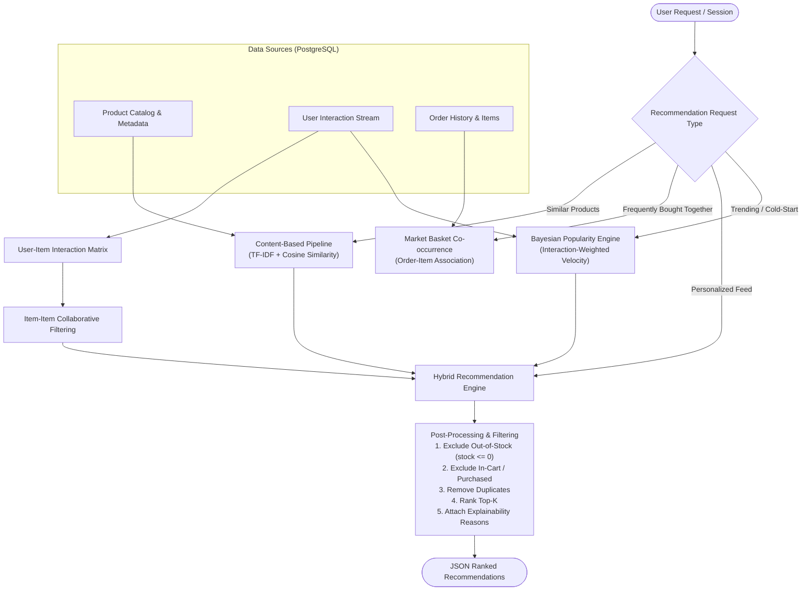

# AI Recommendation Engine Architecture

## 1. Engine Overview & Objectives

The recommendation engine is a core differentiator of the platform. Rather than serving static queries or hardcoded product IDs, the system implements a production-grade machine learning pipeline built on **Scikit-Learn, Pandas, and NumPy**.

It combines:
1. **Content-Based Filtering (CBF)**: Natural language processing (NLP) on product text (names, brands, categories, descriptions, attributes) using TF-IDF vectorization and cosine similarity.
2. **Collaborative Filtering (CF)**: User-item interaction modeling based on explicit (reviews, ratings) and implicit (views, wishlist additions, cart additions, purchases) feedback matrices.
3. **Hybrid Weighted Fusion**: An ensemble algorithm that blends CBF, CF, and catalog popularity signals based on data confidence and cold-start state.
4. **Business Rule Post-Processing**: Filters out out-of-stock inventory, removes already-purchased products (for personal feeds), prevents duplicate recommendations, and attaches explainability annotations.

---

## 2. Interaction Signal Weighting

Implicit interactions are weighted to reflect user intent:

| Interaction Type | Weight ($w_i$) | Business Rationale |
|---|---|---|
| `view` | 1.0 | Low commitment browse signal |
| `search_click` | 1.5 | Active intent discovery |
| `wishlist_add` | 3.0 | Stated future interest |
| `cart_add` | 5.0 | High commercial purchase intent |
| `purchase` | 10.0 | Maximum conversion signal |
| `rating` | Normalized: `(rating - 3) * 2.5` | Range -5.0 (1 star) to +5.0 (5 stars) |

The composite interaction score for user $u$ and product $p$ is calculated as:
$$R_{u, p} = \sum_{e \in \text{events}(u, p)} w_e \times \lambda^{\Delta t_e}$$
where $\lambda = 0.95^{\text{days elapsed}}$ is an exponential time-decay factor ensuring recent interactions carry higher weight than historical ones.

---

## 3. Algorithm Specifications

### A. Content-Based Filtering (CBF)
1. **Corpus Formulation**:
   For each active product $p$, a rich document vector is created:
   $$\text{Doc}_p = \text{Clean}(\text{Title}_p) \times 3 + \text{Category}_p \times 2 + \text{Brand}_p \times 2 + \text{Attributes}_p \times 1.5 + \text{Description}_p$$
   Terms in the title, category, and brand are emphasized via term multiplication.
2. **Vectorization**:
   - `TfidfVectorizer(max_features=5000, stop_words='english', ngram_range=(1, 2))`
   - Computes normalized TF-IDF feature vectors $\vec{v}_p \in \mathbb{R}^D$.
3. **Similarity Matrix**:
   - Cosine similarity: $S_{\text{content}}(i, j) = \frac{\vec{v}_i \cdot \vec{v}_j}{\|\vec{v}_i\| \|\vec{v}_j\|}$.
   - Cached in memory or Redis for sub-millisecond retrieval.

### B. Collaborative Filtering (CF) - Item-Based
Item-Item Collaborative Filtering is chosen over User-User because:
- The catalog size is more stable than the customer user base.
- Item similarity matrices remain computationally tractable and can be precomputed.
- Avoids privacy leakage of user vectors.

1. **Matrix Construction**:
   A sparse interaction matrix $M \in \mathbb{R}^{|U| \times |P|}$ is populated with composite interaction scores $R_{u, p}$.
2. **Item Similarity**:
   Adjusted cosine similarity between column vectors of products $i$ and $j$:
   $$S_{\text{collab}}(i, j) = \cos(\vec{m}_{*, i}, \vec{m}_{*, j})$$
3. **User Scoring**:
   For a given user $u$ with interaction history $H_u = \{(p, r) \mid R_{u, p} > 0\}$:
   $$\hat{Y}_{\text{collab}}(u, j) = \frac{\sum_{i \in H_u} S_{\text{collab}}(i, j) \cdot R_{u, i}}{\sum_{i \in H_u} |S_{\text{collab}}(i, j)|}$$

### C. Market Basket Analysis (Frequently Bought Together)
Identifies products frequently checked out in the same order.
1. Computes co-occurrence matrix $C(i, j)$ across all completed orders in `order_items`.
2. Computes the Jaccard similarity / Lift metric:
   $$\text{Lift}(i, j) = \frac{P(i \cap j)}{P(i) \times P(j)} = \frac{N \cdot \text{count}(i, j)}{\text{count}(i) \cdot \text{count}(j)}$$
3. Returns top $K$ products with highest association lift where $i \neq j$.

### D. Trending & Popularity (Velocity-Weighted)
For cold-start users or guest visitors:
$$\text{Score}_{\text{trending}}(p) = \frac{V_p + 5 \cdot C_p + 10 \cdot O_p}{(T_{\text{now}} - T_{\text{launch}} + 2)^\gamma} \times \left( \frac{\bar{R}_p + m \cdot C_{\text{prior}}}{N_p + m} \right)$$
where:
- $V_p, C_p, O_p$ are views, carts, and orders over the last 14 days.
- $\gamma = 1.2$ is the decay power.
- The right term is a Bayesian average of user star ratings.

---

## 4. Hybrid Recommendation Engine & Fusion Formula

For personalized feeds (`/api/recommendations/personalized`), the score for product $p$ and user $u$ is fused:

$$\text{FinalScore}(u, p) = \alpha \cdot \hat{Y}_{\text{collab}}(u, p) + \beta \cdot \hat{Y}_{\text{content}}(u, p) + \gamma \cdot \text{Score}_{\text{trending}}(p)$$

### Dynamic Weight Adaptation Based on User Data Confidence:
- **Established User** ($> 5$ interactions):
  - $\alpha = 0.50$ (Collaborative)
  - $\beta = 0.40$ (Content)
  - $\gamma = 0.10$ (Trending / Popularity)
- **Sparse User** ($1 - 4$ interactions):
  - $\alpha = 0.20$ (Collaborative is sparse)
  - $\beta = 0.60$ (Content dominates from viewed items)
  - $\gamma = 0.20$ (Popularity anchor)
- **Cold-Start User** ($0$ interactions):
  - $\alpha = 0.00$
  - $\beta = 0.00$
  - $\gamma = 1.00$ (Trending & Bayesian Popularity)

---

## 5. Post-Processing & Guardrails

Before returning recommendations to the client:
1. **Out-of-Stock Filter**: Every candidate product must satisfy `stock > 0` and `is_active = TRUE`. Out-of-stock items are strictly excluded.
2. **Purchase Deduplication**: In personalized feeds, products previously purchased by the user are excluded unless categorized as consumable/repeat-order.
3. **Cart Exclusion**: Items currently in the customer's active cart are excluded to avoid redundant recommendations.
4. **Diversity Re-Ranking**: Ensures no single brand or narrow subcategory occupies more than 40% of the top 10 positions.
5. **Explainability Annotation**: Every recommendation includes a machine-generated reason:
   - *"Because you viewed [Product Name]"*
   - *"Frequently bought with items in your cart"*
   - *"Top rated in [Category Name]"*
   - *"Based on your interest in [Brand Name]"*

